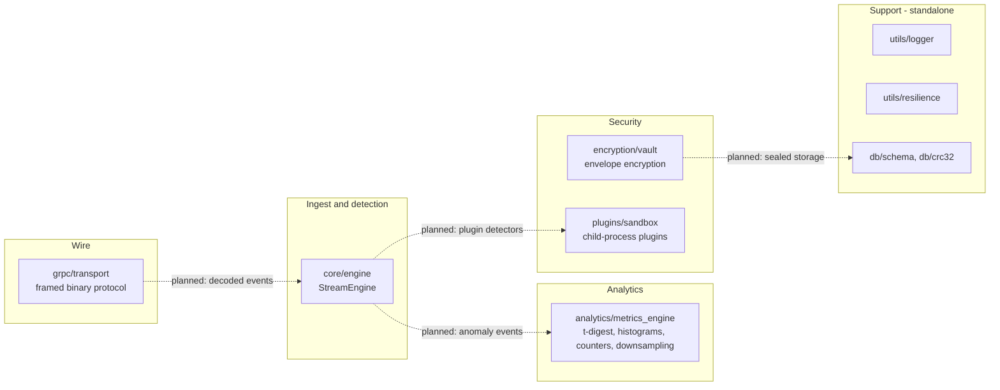

# NexusPulse architecture

NexusPulse is a single TypeScript codebase made of independent modules. Each
module has no runtime dependencies beyond Node.js and can be tested on its own.

## Module map

Each module is self-contained. **No module currently imports another module
from `src/`.** The integration wiring (transport frames into the engine, anomaly
events into the metrics engine, and so on) is designed but not yet built. The
dashed arrows below show the intended integration points, not existing code.

## Modules

### `src/core/engine.ts`: stream processing engine

Validates telemetry events, keeps bounded per-series statistics, runs pluggable
detectors, and suppresses repeat alerts.

- Pipeline: validate → bounded queue (drop-oldest, drop-newest or reject) →
  late-event and duplicate filter → detectors → baseline update → cooldown →
  `anomaly` event.
- Memory is bounded: queue capacity, per-series window, per-series dedup cache,
  and a series limit with LRU eviction.
- A failing detector or listener is reported through the `error` event and
  never stops the pipeline.
- Lifecycle: `idle` → `running` (background flush) → `stopped` (terminal, after
  draining the queue).

### `src/encryption/vault.ts`: envelope encryption

AES-256-GCM envelopes with per-message data keys wrapped under a versioned key
encryption key. Supports key rotation with re-wrapping of stored envelopes. See
[security-model.md](security-model.md#2-envelope-encryption-vault-srcencryptionvaultts)
for limits.

### `src/grpc/transport.ts`: framed binary transport

A 16-byte header, length-prefixed frames, stream multiplexing with per-stream
send windows, PING/PONG keep-alive with RTT measurement, GOAWAY shutdown, and a
TLV codec for application records. It is not gRPC. See
[security-model.md](security-model.md#3-transport-srcgrpctransportts).

### `src/plugins/sandbox.ts`: plugin sandbox

Loads plugin source into child processes with a heap cap, a per-call watchdog,
capability-checked host calls, quotas, and hot reload with rollback. Reloads
start the new version first and swap it in only after it loads successfully.
KV state and logs survive reloads and crash restarts. See
[security-model.md](security-model.md#1-plugin-sandbox-srcpluginssandboxts).

### `src/analytics/metrics_engine.ts`: analytics

- `TDigest`: merging t-digest with the k1 scale function. Measured error on
  100,000 uniform samples: about 0.07% of range at the median and 0.013% at
  p99.9, with 60 centroids.
- `SlidingWindowHistogram`: time-sliced ring of digests and cumulative buckets.
- `CounterRegistry`: monotonic labelled counters with a cardinality cap.
- `downsample` and `lttb`: fixed-bucket aggregation and shape-preserving
  reduction.
- `MetricsEngine`: facade with lazy creation and series limits.

### `src/utils/` and `src/db/`

- `utils/logger.ts`: structured JSON logger with an injectable sink. Logging
  never throws, and dropped records are counted.
- `utils/resilience.ts`: retry with jittered backoff, a count-based circuit
  breaker, a bulkhead, and a timeout wrapper. Time and randomness are injectable.
- `db/schema.ts`: a small schema language with validation that collects every
  issue.
- `db/crc32.ts`: table-driven CRC-32 (IEEE 802.3).

## Planned data flow for one telemetry event

This is the intended path. Steps 1 and 5 depend on integration code that does
not exist yet. Steps 2 to 4 are implemented and tested inside `StreamEngine`.

1. A client frame arrives on a transport stream and is decoded (planned).
2. `StreamEngine.submit` validates the event. Invalid events are rejected with a
   `dropped` event; nothing is thrown to the caller.
3. The queue holds the event until `flush` or the background loop runs it.
4. Detectors evaluate the event against statistics that exclude the event
   itself.
5. Findings that survive cooldown are emitted as `anomaly` events. A listener
   can forward them to `MetricsEngine` or to a plugin.

## Design decisions

- **Dependency-free core.** The engine, transport, vault and analytics use only
  Node built-ins, which keeps the supply-chain surface small.
- **Injectable clocks and randomness.** Every time-dependent component accepts
  a clock, so tests are deterministic and never sleep.
- **Errors carry stable codes.** Each module exports a base error class with a
  `code` string, so callers can branch on the code rather than the message.
- **Bounded memory.** Queues, windows, caches and series maps in the engine and
  analytics all have hard limits, and tests cover each one.
